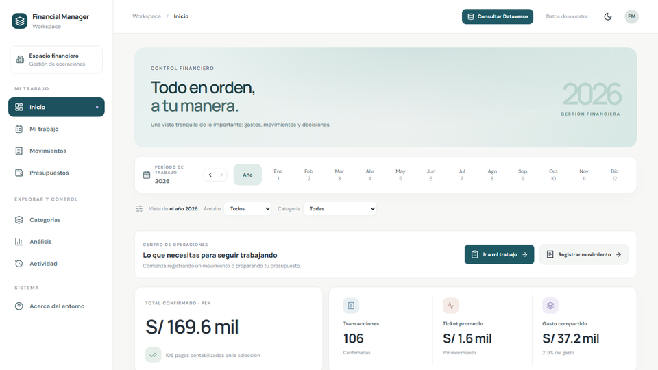
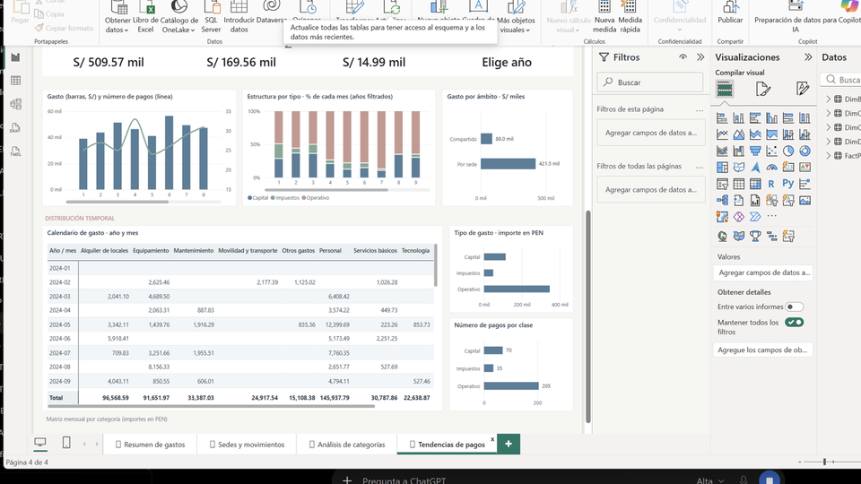
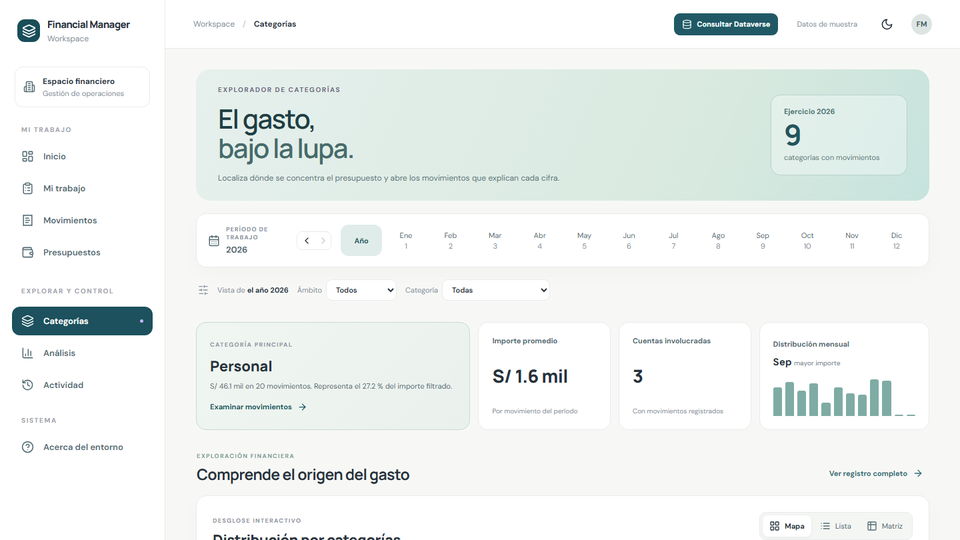
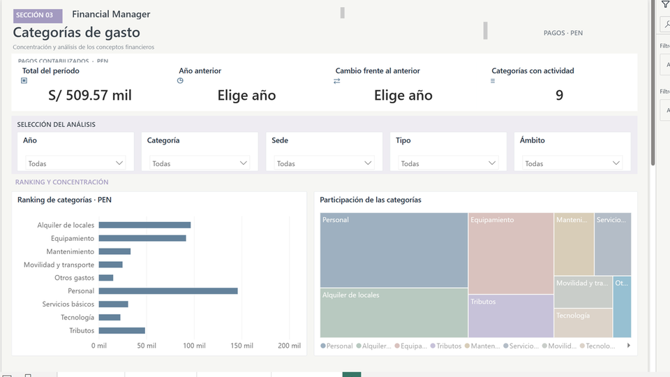
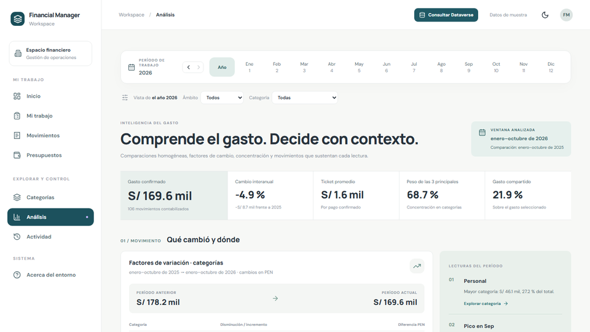
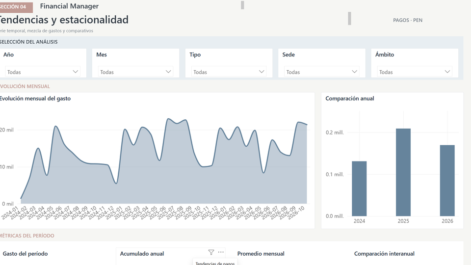
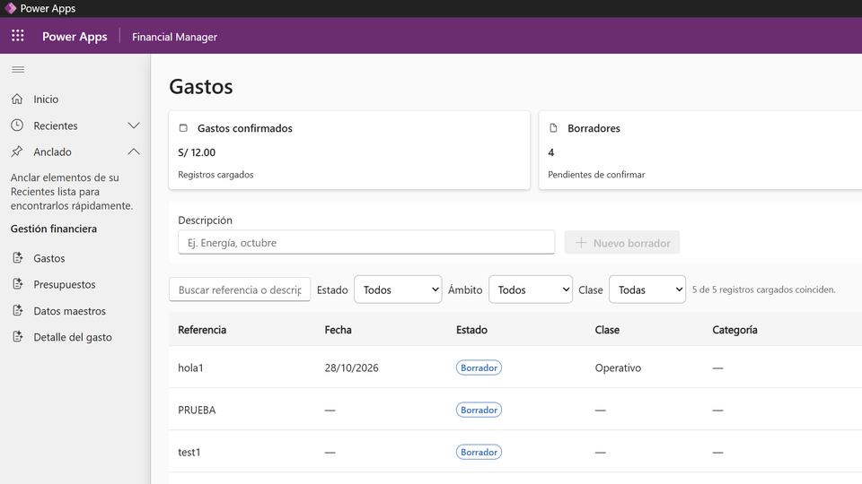
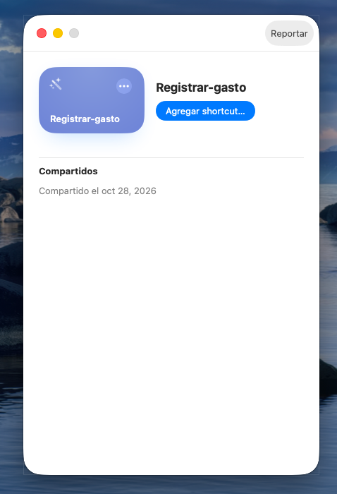
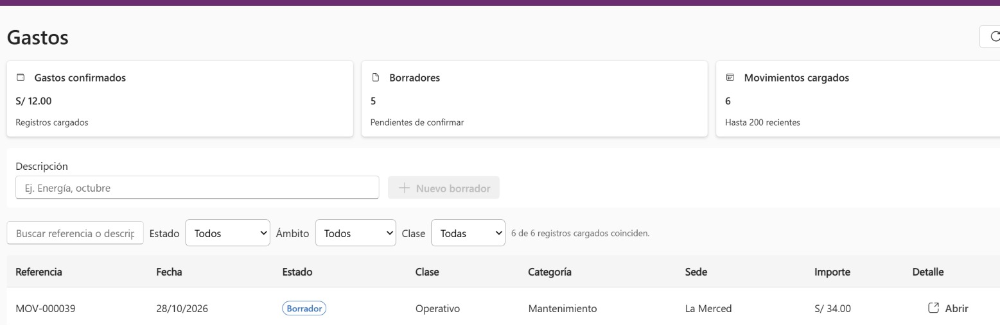

# Financial Manager

Financial Manager is a Microsoft Power Platform project for internal cash-oriented financial control, budget allocation, and management reporting. It is designed for a small business with multiple operating locations. Customer management, electronic invoicing, and formal accounting remain outside the application.

## Technology

- Power Apps: financial movement and budget workflows
- Microsoft Dataverse: operational records, authorization, and auditing
- Power BI: financial analysis, comparisons, and budget reporting
- Financial workspace (React): [Financial Workspace](apps/financial-workspace/README.md), with separate synthetic DEMO and delegated Dataverse LIVE modes; LIVE Draft operations and protected actions are subject to server authorization
- Power Automate: approved workflow actions and optional future integrations

## Preview

<table>
  <tr>
    <th width="50%" align="center">React</th>
    <th width="50%" align="center">Power BI</th>
  </tr>
  <tr>
    <td align="center"><strong>Home</strong>

</td>
    <td align="center"><strong>Expense overview</strong>

</td>
  </tr>
  <tr>
    <td align="center"><strong>Categories</strong>

</td>
    <td align="center"><strong>Category analysis</strong>

</td>
  </tr>
  <tr>
    <td align="center"><strong>Analysis</strong>

</td>
    <td align="center"><strong>Trends</strong>

</td>
  </tr>
</table>

<table>
  <tr><th align="center">Power Apps</th></tr>
  <tr>
    <td align="center"><strong>Expense management</strong>

</td>
  </tr>
</table>

Project screenshots: React in DEMO mode with synthetic data; Power BI Desktop; Power Apps in the DEV environment.

## iOS Shortcut

[Registrar gasto](integrations/ios-shortcuts/README.md) provides native expense entry. The Mail variant stages requests for review; **Registrar gasto (Microsoft)** uses delegated Entra sign-in and creates a Dataverse `Draft`. The direct Draft flow was accepted on macOS in DEV; iPhone acceptance remains separate.

## Shortcut to Draft

<table>
  <tr>
    <th width="60%" align="center">Expenses in Power Apps</th>
    <th width="40%" align="center">Authenticated Draft result</th>
  </tr>
  <tr>
    <td align="center"></td>
    <td align="center"></td>
  </tr>
</table>

FM-11 acceptance screenshots from the DEV environment on macOS. The new record stays in Draft; no payment was approved or posted.

## Documentation

| Topic | Document |
| --- | --- |
| Scope and exclusions | [Scope](docs/scope.md) |
| Components and data flow | [Architecture](docs/architecture.md) |
| Tables and integrity rules | [Data model](docs/data-model.md) |
| Validation implementation options | [Validation strategy](docs/validation-strategy.md) |
| Internal expense codes | [Category catalog](docs/category-catalog.md) |
| Indicators and Power BI report pages | [Reporting](docs/reporting.md) |
| Power Apps navigation and interactions | [Screens](docs/screens.md) |
| Roles and audit requirements | [Security](docs/security.md) |
| Acceptance and reconciliation tests | [Verification](docs/verification.md) |
| Environment and repository workflow | [Development](docs/development.md) |
| Optional integrations | [AI](integrations/ia/README.md) · [Fabric](integrations/fabric/README.md) |
| Architecture decisions | [ADRs](docs/decisions/) |

## Repository

| Path | Purpose |
| --- | --- |
| `docs/` | Product and technical specifications |
| `power-platform/` | Real solution source after exporting from Dataverse |
| `power-bi/` | Real PBIP source after saving in Power BI Desktop |
| `integrations/` | Optional iOS and conversational reporting specifications |
| `integrations/ia/` | Optional AI integration scope; not deployed |
| `scripts/` | Repository checks |
| `tests/` | Automated repository validation |
| `apps/financial-workspace/` | Responsive React workspace with isolated DEMO data and delegated Dataverse LIVE operations; not a Fabric app |

## Working principles

Keep application source in supported Microsoft formats; do not fabricate generated files. Validate financial metrics using controlled synthetic transactions, test role permissions independently of UI visibility, and exclude actual company records, personal data, credentials, and production exports from Git.

Read [Development](docs/development.md) before building platform components.
