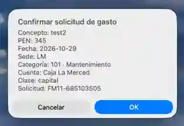
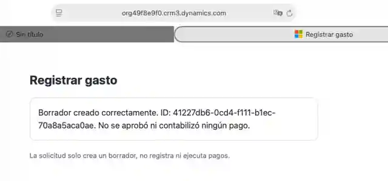

# Registrar gasto — Apple Shortcuts

Native expense entry for Financial Manager. The shortcut collects the name,
amount (PEN), date, category, branch, account, expense class, and description.
A confirmation dialog appears before transmission.

## Preview

<table>
  <tr>
    <th width="45%" align="center">Review the request</th>
    <th width="55%" align="center">Draft saved to Dataverse</th>
  </tr>
  <tr>
    <td align="center"></td>
    <td align="center"></td>
  </tr>
</table>

<sub>Real acceptance screenshots on macOS in DEV. The second screen confirms a Draft only, not payment approval.</sub>

## Files

| File | Purpose |
| --- | --- |
| `Registrar-gasto-v2.unsigned.shortcut` | Current **Registrar gasto** (Mail without compose sheet) |
| `Registrar-gasto.unsigned.shortcut` | Original compose-sheet version |
| `Registrar-gasto-http.unsigned.shortcut` | Optional HTTP diagnostic, not for production |

The unsigned binaries are generated from the matching Python scripts.
The name displayed in Shortcuts remains **Registrar gasto**, without a
version suffix.

## Sign and import on macOS

Download `Registrar-gasto-v2.unsigned.shortcut` into `~/Downloads`, then:

```bash
cd ~/Downloads
shortcuts sign --mode anyone \
  --input Registrar-gasto-v2.unsigned.shortcut \
  --output Registrar-gasto.shortcut
open -a Shortcuts Registrar-gasto.shortcut
```

On import, specify the authorized business mailbox. Configure a sending
account in Apple Mail. `Show Compose Sheet` is disabled, and the subject
is `FM11-DRAFT-V1`.

## Verify delivery

Run **one synthetic request** and check the sent message before connecting
the receiver. The email body must be valid JSON with these fields:
`requestId`, `name`, `amountPen`, `date`, `categoryCode`,
`branchCode`, `accountName`, `flowClass`, and `description`.

For example, selecting `103 · Infraestructura / Red` must produce
`"categoryCode":"103"`, never an empty string. The shortcut splits the
selected label on ` · ` and uses the first item; it stops if no value
is produced. It also stops if the email body is empty.

Confirm delivery and JSON format on both macOS and iPhone. A successful Mail
send alone does not confirm delivery to Outlook or creation in Dataverse.

## Rebuild and test

```powershell
python integrations/ios-shortcuts/build_shortcut_v2.py
python -m unittest tests.test_fm11_ios_v2 tests.test_ios_shortcuts_source -v
```

See [Power Automate](../power-automate/README.md) for the DEV receiver and
Dataverse staging. The receiving flow must stay disabled until the user's
identity, message format, duplicates and review process are accepted.


## Delegated Microsoft sign-in variant (pending iPhone acceptance)

`Registrar-gasto-entra.unsigned.shortcut` keeps the native expense selectors
but opens the Financial Manager Dataverse web resource in Safari instead of
sending an email. The displayed name is **Registrar gasto (Microsoft)** so it
does not replace the proven Mail shortcut until accepted.

The page `fmg_shortcut_draft.html` performs Entra authorization code flow
with **PKCE S256**, using browser-only cryptographic randomness. It stages a
request as the signed-in Dataverse user and calls the existing private
`fmg_CreateDraftFromMailIntake` API. Tokens are not embedded in the shortcut,
sent by Mail or retained in local storage. The API still enforces permissions,
live account/category checks, transaction rollback and unique request IDs.

The HTML web resource is deployed in DEV. The existing Entra registration
(client `d6ad936e-45ae-4d21-b04f-d04397f0bc2b`) now lists this exact
redirect under **Authentication → Single-page application (SPA)**, verified
in the Entra portal on October 29, 2026:

```text
https://org49f8e9f0.crm3.dynamics.com/WebResources/fmg_shortcut_draft.html
```

The existing desktop/mobile redirects were preserved. The caller must still
have delegated Dataverse `user_impersonation` consent and the appropriate
financial privileges. An SPA redirect registration does **not** confirm
successful iPhone sign-in or Dataverse authorization. No app secret,
shared mailbox identity or new subscription is used.

The Microsoft variant now builds the handoff using Shortcuts' native **URL** action, rather than opening a dynamically interpolated Text action as a URL. If Safari shows **No se recibieron los datos del gasto**, the `#draft=` fragment was not delivered. Sign in to Dataverse in Safari first if needed, then rerun **Registrar gasto (Microsoft)** from Shortcuts; authentication redirects can discard URL fragments. Never paste the fragment, authorization code, or browser callback into chat.

For a device acceptance test, sign this *separate* binary on macOS:

```bash
shortcuts sign --mode anyone \
  --input Registrar-gasto-entra.unsigned.shortcut \
  --output Registrar-gasto-entra.shortcut
open -a Shortcuts Registrar-gasto-entra.shortcut
```

Test with synthetic data on iPhone. Safari must show the Microsoft login
and then confirm a Dataverse `Draft`. A failure must not produce a financial
record. The authenticated Draft creation succeeded on macOS Safari in DEV;
an iPhone-only acceptance test remains pending. Mocked OAuth tests and
resource read-back are not substitutes for that device test.

The original Mail shortcut and the Off intake receiver remain unchanged.
